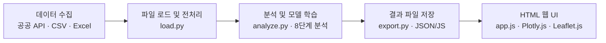

# Property Estimate

서울시 아파트 가격 결정요인을 분석하고, AI 기반 가격 예측 결과를 시각화하는 프로젝트입니다.
가격 예측뿐 아니라 **어떤 요인이 아파트 가격과 가장 밀접하게 관련되어 있는지, 각 요인의 상대적 중요도가 어떻게 다른지**를 파악하는 데 중점을 둡니다.

> 현재 기획 및 데이터 준비 단계입니다. 아래 데이터 수집 파이프라인, 분석 모델, 웹 애플리케이션은 개발 예정이며, 분석 결과나 모델 성능은 아직 산출되지 않았습니다.

## 프로젝트 개요

| 항목 | 내용 |
| --- | --- |
| 저장소 | [roongji5/property-estimate](https://github.com/roongji5/property-estimate) |
| 분석 지역 | 서울특별시 25개 자치구 |
| 분석 기간 | 2018~2025년 예정 — 데이터 확보 상황에 따라 조정 |
| 분석 대상 | 아파트 매매 실거래가 |
| 주요 분석 영역 | 학군·교육환경, 대중교통, 직주근접, 정부 정책, 지역 급지, 아파트 특성 |
| 주 개발 언어 | Python |
| 실행 환경 | 로컬 PC에서 실행하는 웹 애플리케이션 개발 예정 |
| 협업 도구 | Git, GitHub |

각 영역에 적합한 통계분석과 머신러닝 방법을 적용해 개별 관계를 분석한 뒤, 통합 예측모델에서 변수별·요인군별 중요도를 비교할 예정입니다. 추가로 TensorFlow/Keras 기반 MLP 모델을 구현해 머신러닝 모델과 예측 성능을 비교할 계획입니다.

## 핵심 연구 질문

- 서울시 아파트 가격과 가장 밀접하게 관련된 요인은 무엇인가?
- 학군과 교통 접근성 중 어느 변수가 가격 예측에 더 중요한가?
- 주요 업무지구까지의 통근시간은 가격과 어떤 관계를 갖는가?
- 정부 부동산 정책 시행 전후 아파트 가격에 어떤 변화가 나타나는가?
- 상급지와 하급지의 가격 결정요인에는 어떤 차이가 있는가?
- 상급지 구축 아파트와 하급지 신축 아파트의 가격 차이는 어떠한가?
- 머신러닝과 딥러닝 중 어떤 모델이 집값을 더 정확하게 예측하는가?

## 데이터 수집 계획

가능한 경우 공공데이터 API로 자동 수집하고, API를 지원하지 않는 자료는 CSV, Excel 또는 공개 통계자료로 확보할 예정입니다. 수집 과정에서 자료의 공간·시간 단위, 갱신 주기, 이용 조건과 결측 여부를 기록할 계획입니다.

**아래 링크는 수집 후보 출처입니다. 링크 접근 가능 여부, API 이용 가능 여부, 필요한 변수와 과거 기간의 제공 여부는 전체 검증이 완료되지 않았습니다.** 출처 등록이 데이터 확보나 API 연결 완료를 의미하지 않습니다.

| 분석 영역 | 수집 후보 출처 | 주요 수집 항목 및 파생변수 계획 |
| --- | --- | --- |
| 아파트 매매가격 | [국토교통부 실거래가](https://rt.molit.go.kr/pt/xls/xls.do)<br>[아파트 매매 실거래가 API](https://www.data.go.kr/data/15126469/openapi.do)<br>[한국부동산원 R-ONE](https://www.reb.or.kr/r-one/portal/dashboard/statsVisualPage.do) | 거래금액, 거래일자, 전용면적, 아파트명, 위치, 층수, 건축년도 및 시장 가격 추이 |
| 학군·교육환경 | [학교 위치 및 기본정보](https://www.data.go.kr/data/15021148/standard.do)<br>[서울시 학원·교습소 정보](https://data.seoul.go.kr/dataList/OA-23036/S/1/datasetView.do)<br>[서울교육통계](https://www.data.go.kr/data/3070110/fileData.do)<br>[학교알리미](https://www.schoolinfo.go.kr)<br>[에듀데이터서비스](https://www.edmgr.kr) | 학교 위치, 학원 밀집도, 학교 접근성, 교원 수, 확보 가능한 경우 학업성취도 |
| 대중교통 | [지하철역 좌표정보](https://t-data.seoul.go.kr/dataprovide/trafficdataviewfile.do?data_id=36)<br>[자치구별 지하철역 정보](https://www.data.go.kr/data/15081868/fileData.do)<br>[버스정류소 위치정보](https://data.seoul.go.kr/dataList/OA-15067/S/1/datasetView.do)<br>[교통카드 빅데이터](https://stcis.go.kr/wps/main.do) | 지하철역 거리, 환승역 접근성, 버스정류장 밀도, 대중교통 이동시간 |
| 직주근접 | [서울시 사업체·종사자 통계](https://data.seoul.go.kr/dataList/96/S/2/datasetView.do?obj_var_id=A&up_itm_id=001017)<br>[교통카드 빅데이터](https://stcis.go.kr/wps/main.do)<br>[SGIS](https://sgis.mods.go.kr) | 사업체 수, 종사자 수·밀도, 주요 업무지구 접근성, 통근시간 |
| 정부 부동산 정책 | [국토교통부](https://www.molit.go.kr)<br>[서울부동산정보광장](https://land.seoul.go.kr/land/other/appointStatusSeoul.do)<br>[서울시 정비사업 추진현황](https://news.seoul.go.kr/citybuild/plan-progress)<br>[한국은행 ECOS](https://ecos.bok.or.kr) | 규제지역 지정·해제일, 토지거래허가구역 지정, 재건축·재개발 정책, 거시경제 통제변수로 사용할 기준금리 |
| 지역·급지 | [행정구역 경계 데이터](https://www.data.go.kr/data/15129688/fileData.do)<br>[SGIS 자료제공](https://sgis.mods.go.kr/view/pss/openDataIntrcn)<br>[한국부동산원 R-ONE](https://www.reb.or.kr/r-one/portal/dashboard/statsVisualPage.do)<br>[서울 열린데이터광장](https://data.seoul.go.kr) | 행정구역 경계, 지역별 통계, 지역 특성 및 급지 분류에 필요한 지표 |
| 아파트 특성 | [건축물대장정보 API](https://www.data.go.kr/data/15134735/openapi.do)<br>[국토교통부 실거래가](https://rt.molit.go.kr/pt/xls/xls.do)<br>[GIS 건물정보 API](https://www.data.go.kr/data/15123552/openapi.do) | 건축연도, 사용승인일, 면적, 층수, 단지 규모, 신축·구축 여부 |

급지는 별도의 기준을 정의해 상급지·중급지·하급지로 분류할 예정입니다. 분류에 가격을 사용한다면 동일 가격을 설명하는 독립적인 원인으로 해석하지 않고, 기술적 비교를 위한 집단 구분으로 다룰 계획입니다. 신축·구축의 연식 기준도 분석 전에 명시할 예정입니다.

## 분석 방법 및 평가 계획

분석은 아래 8단계 순서로 진행할 예정입니다. 서울시 전체 가격 흐름을 살펴본 뒤 지역과 개별 요인의 관계를 분석하고, 가격 예측 모델 비교와 주요 결정요인 종합 분석으로 마무리합니다. 각 방법은 데이터 품질, 표본 규모와 분석 가정 충족 여부를 확인해 적용할 계획입니다.

### 주제별 추천 알고리즘 총정리

| 순서 | 분석 주제 | 추천 알고리즘 | 핵심 목적 |
| --- | --- | --- | --- |
| 1 | 서울시 아파트 가격 현황 및 추이 | 시계열 분석, 이동평균 | 집값 변화 흐름 파악 |
| 2 | 지역별 급지에 따른 가격 차이 | ANOVA, K-means | 급지별 가격 격차 검증 |
| 3 | 아파트 자체 특성과 가격 차이 | 다중선형회귀, Random Forest | 연식·면적·층수의 중요도 |
| 4 | 학군·교육환경과 가격의 관계 | 다중선형회귀, Random Forest | 학군 프리미엄 분석 |
| 5 | 대중교통·직주근접과 가격의 관계 | 다중선형회귀, Random Forest | 교통·일자리 접근성 분석 |
| 6 | 정부 정책 시행 전후 가격 변동 | DID(이중차분법), 이벤트 스터디 | 정책 전후 변화 분석 |
| 7 | AI 기반 아파트 가격 예측 | Random Forest, XGBoost, MLP | 모델별 가격 예측 성능 비교 |
| 8 | 주요 가격 결정요인 종합 분석 | Permutation Importance, SHAP | 변수별 예측 기여도 비교 |

K-means 군집에는 자동으로 급지의 높고 낮음이 부여되지 않으므로, 군집 특성을 해석한 뒤 사전에 정한 기준과 함께 검토할 예정입니다.

### 통합 데이터셋 및 모델 평가

1. 거래자료와 외부 지표를 위치·시점 기준으로 연결하고, 중복·결측·이상치를 점검할 예정입니다.
2. 거래금액과 면적당 가격의 활용 목적을 구분하고, 비교에 사용할 예측 대상과 단위를 일관되게 정의할 예정입니다.
3. 거래 시점, 위치, 면적, 연식 등 확보 가능한 교란변수를 고려해 요인별 분석을 수행할 예정입니다.
4. 학습·검증·평가 데이터를 분리하고, 시간 순서 및 지역·단지 중복에 따른 정보 누출을 점검할 예정입니다. 전처리와 군집화 등 학습이 필요한 과정은 학습 데이터에서만 적합할 계획입니다.
5. Random Forest, XGBoost, TensorFlow/Keras 기반 MLP를 공통 평가 데이터에서 비교할 예정입니다. 평가지표로 **MAE, RMSE, R²**를 사용할 계획입니다.
6. 통합 모델의 Permutation Importance를 기준으로 변수와 요인군을 비교하고, 요인군을 제외했을 때의 성능 변화도 검토할 예정입니다. SHAP으로 개별 예측과 전체 변수별 예측 기여도를 함께 해석할 예정입니다.

### 결과 해석 원칙

- 개별 분석의 상관계수, 회귀계수, DID 추정치는 단위와 의미가 다르므로 직접 비교하거나 합산해 영향력 순위를 만들지 않을 예정입니다.
- 최종 중요도 비교는 공통 평가 데이터와 일관된 기준을 사용하는 통합 모델에서 수행할 예정입니다. 서로 상관된 변수는 중요도가 나뉠 수 있어 요인군 단위 결과도 함께 검토할 계획입니다.
- **예측 중요도는 인과적 영향력을 의미하지 않습니다.** 가격과의 연관성, 예측 기여도, 인과효과 추정을 구분해 보고할 예정입니다.
- DID는 적절한 처치·비교집단과 평행추세 등의 가정을 검토한 경우에만 적용할 예정입니다. 정책 전후 가격 차이만으로 정책의 인과효과를 단정하지 않을 계획입니다.
- 분석 결과에는 데이터 범위, 불확실성, 지역·기간별 차이와 방법론적 한계를 함께 기록할 예정입니다.

## 개발 예정 기술 스택

아래는 현재 계획 중인 기술 스택이며, 설치 또는 구현 완료를 의미하지 않습니다.

| 분야 | 예정 기술 |
| --- | --- |
| 주 개발 언어 | Python |
| 데이터 수집 | Requests, REST API |
| 데이터 처리 | Pandas, NumPy |
| 통계분석 | SciPy, Statsmodels |
| 머신러닝 | Scikit-learn, XGBoost |
| 예측 기여도 분석 | Permutation Importance, SHAP |
| 딥러닝 | TensorFlow / Keras |
| 공간정보 처리 | GeoPandas |
| 웹 프론트엔드 | HTML, CSS, JavaScript |
| 데이터 시각화 | Plotly.js, Matplotlib, Seaborn |
| 지도 시각화 | Leaflet.js |
| 데이터 및 결과 저장 | CSV, Excel, JSON/JS 파일 (DB 미사용) |
| 협업 | Git, GitHub |

## 로컬 웹 프로그램 개발 계획

별도의 데이터베이스를 연결하지 않고, CSV·Excel 파일을 Python으로 불러와 분석할 예정입니다. 분석 결과와 예측 결과는 JSON/JS 파일로 내보내고, HTML·CSS·JavaScript UI에서 읽어 로컬 PC의 브라우저에 시각화할 계획입니다.

웹 화면도 8단계 분석 흐름에 맞춰 다음 결과를 보여줄 예정입니다.

1. 서울시 아파트 가격 현황·분포 지도 및 시계열 추이
2. 지역별 급지에 따른 가격 격차
3. 연식·면적·층수 등 아파트 자체 특성과 가격의 관계
4. 학군·교육환경과 가격의 관계
5. 대중교통·직주근접과 가격의 관계
6. 정부 정책 시행 전후 가격 변화
7. Random Forest·XGBoost·MLP의 가격 예측 결과 및 성능 비교
8. Permutation Importance·SHAP 기반 변수별 예측 기여도

### 시스템 아키텍처 (예정)



`main.py`에서 데이터 로드, 분석, 결과 내보내기를 순서대로 실행하도록 구성할 예정입니다. `src/export.py`가 생성한 `web/results.js`를 웹 화면에서 읽어 차트와 지도를 그립니다. 데이터가 변경되면 Python 분석을 다시 실행해 결과 파일을 갱신하며, DB 구축이나 연결은 하지 않습니다.

## 디렉터리 구조

아래는 개발 예정 구조입니다. `web/results.js`는 `src/export.py`가 분석 결과를 저장하면서 생성하는 자동생성물입니다.

```text
project/
├── data/
│   └── data.csv
├── src/
│   ├── load.py
│   ├── analyze.py
│   └── export.py     # 결과를 json/js로 저장
├── web/
│   ├── index.html
│   ├── style.css
│   ├── app.js        # 차트 그리기
│   └── results.js    # export.py가 생성 (자동생성물)
└── main.py
```

API 키는 로컬 `.env` 파일에 저장하고 `.gitignore`에 등록해 Git 추적에서 제외할 예정입니다. `.env.example`에는 실제 키 없이 필요한 환경변수 이름과 예시만 제공할 계획입니다.

## 개발 로드맵

아래 체크리스트는 완료 여부를 검증할 작업 단위입니다. 초기 Git 저장소와 README는 마련되어 있으나, 전체 협업 환경 구성과 데이터 검증을 포함한 각 단계는 아직 완료 처리하지 않았습니다.

- [o] 프로젝트 및 Git 협업 환경 구성
- [ ] 공공데이터 API 연결
- [o] 아파트 실거래가 수집
- [ ] 학군 데이터 수집
- [ ] 대중교통 데이터 수집
- [ ] 직주근접 데이터 수집
- [ ] 부동산 정책 데이터 수집
- [ ] 지역 급지 및 아파트 특성 데이터 정리
- [ ] 통합 데이터셋 구축
- [ ] 1단계: 서울시 아파트 가격 현황 및 추이 분석 (시계열 분석, 이동평균)
- [ ] 2단계: 지역별 급지에 따른 가격 차이 분석 (ANOVA, K-means)
- [ ] 3단계: 아파트 자체 특성과 가격 차이 분석 (다중선형회귀, Random Forest)
- [ ] 4단계: 학군·교육환경과 가격의 관계 분석 (다중선형회귀, Random Forest)
- [ ] 5단계: 대중교통·직주근접과 가격의 관계 분석 (다중선형회귀, Random Forest)
- [ ] 6단계: 정부 정책 시행 전후 가격 변동 분석 (DID, 이벤트 스터디)
- [ ] 7단계: AI 기반 아파트 가격 예측 및 성능 비교 (Random Forest, XGBoost, MLP)
- [ ] 8단계: 주요 가격 결정요인 종합 분석 (Permutation Importance, SHAP)
- [ ] 분석·예측 결과 JSON/JS 내보내기
- [ ] HTML 웹 UI 개발
- [ ] 분석 결과 시각화
- [ ] 통합 테스트
- [ ] 최종 발표 및 보고서 작성

## 실행 안내 및 예정 산출물

현재 실행 가능한 애플리케이션과 의존성 명세는 제공되지 않습니다. 실행 환경이 구현되면 Python 버전, 패키지 설치, API 키 설정, 데이터 수집, 모델 학습, JSON/JS 결과 생성 및 로컬 웹 화면 실행 방법을 추가할 예정입니다.

최종 산출물로 통합 데이터셋의 구성·변수 정의서, 요인별 분석 보고서, 모델별 성능 비교표, 변수 중요도 결과, 로컬 웹 애플리케이션 및 최종 발표 자료를 준비할 계획입니다. 현재 공개된 분석 결과나 검증된 예측 정확도는 없습니다.
