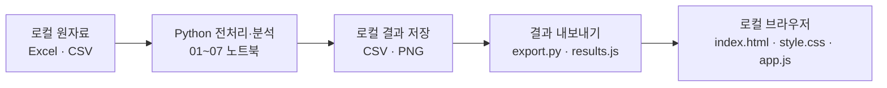

# Property Estimate

서울시 아파트 실거래가를 바탕으로 **가격 흐름과 아파트 특성·교육환경·직주근접·정책·금리의 관계**를 분석하는 프로젝트입니다. 법정동별 모형 가격과 실제 가격의 차이를 비교하고, 금리·통근 여건 변화에 따른 시나리오도 계산합니다.

현재 01~07번 분석 노트북과 결과 파일을 작성했습니다. 다음 단계는 결과를 통합하여 **DB 없이 로컬 PC에서 실행되는 HTML·CSS·JavaScript 화면**으로 보여주는 것입니다. 웹 화면과 결과 내보내기 자동화는 아직 구현하지 않았습니다.

> 아래 수치는 2026-11-17 기준 저장된 실행 결과입니다. 가격의 단순 변화, 통계적 연관성, 예측 성능, 가정에 따른 시나리오는 서로 구분합니다. 현재 저평가 지표와 급지 선행 신호의 미래 상승 예측력은 확인되지 않았습니다.

## 프로젝트 개요

| 항목 | 내용 |
| --- | --- |
| 저장소 | [roongji5/property-estimate](https://github.com/roongji5/property-estimate) |
| 분석 지역 | 서울특별시 25개 자치구, 거래가 관측된 338개 법정동 |
| 원자료 기간 | 2017-10-28~2026-10-26 |
| 실거래 자료 | 원본 547,735건, 취소·기본 오류 제외 후 530,129건 |
| 분석 대상 | 아파트 매매가격, ㎡당 가격, 구성 보정 가격지수 |
| 주요 분석 영역 | 가격 추이, 급지, 아파트 특성, 교육환경, 직주근접, 정책, 금리, 동별 가격 괴리 |
| 구현 상태 | 01~07 분석 및 노트북 시각화 구현, 최종 통합 평가·로컬 웹 화면 예정 |
| 분석 환경 | Python, Jupyter Notebook |
| 결과 화면 계획 | HTML·CSS·JavaScript, 로컬 파일 기반, DB 미사용 |
| 협업 도구 | Git, GitHub |

노트북마다 필요한 변수와 관측기간이 달라 실제 분석 건수는 다릅니다. 02번은 완결 월인 2017-11~2026-09, 03번은 층·연식 조건을 적용한 529,983건, 07번은 2018Q1~2026Q3의 510,544건을 사용합니다. 금리 분석은 자료 범위에 따라 2024-07 또는 2024Q2까지만 수행합니다.

## 핵심 연구 질문

- 서울 아파트의 거래가격과 거래량은 시기·지역별로 어떻게 달라졌는가?
- 가격으로 분류한 급지 사이에 선행·후행 관계가 나타나는가?
- 면적·연식·층, 교육환경, 주요 업무지구 접근성은 가격과 어떤 관계가 있는가?
- 정부 대책과 토허제 지정 전후에 관측 가격은 얼마나 변했는가?
- 금리 변화와 가격 변화의 관계는 시차·지역별로 어떻게 달라지는가?
- 모형 가격보다 낮은 동이 이후 실제로 더 많이 상승했는가?
- 금리·통근시간 등 가정을 바꾸면 모형 계산값은 어떻게 달라지는가?

## 데이터 수집 및 활용 현황

분석은 저장소의 Excel·CSV 자료를 중심으로 수행합니다. 05번의 대중교통 소요시간은 Google Routes API 조회 결과를 CSV로 저장해 재사용합니다. 자료를 보유한 것과 분석 변수로 사용한 것은 구분합니다.

| 분석 영역 | 보유 자료 및 위치 | 현재 활용 |
| --- | --- | --- |
| 실거래가·아파트 특성 | `data/서울_아파트_매매_실거래가_2017-2026_통합.xlsx` | 계약일, 거래금액, 면적, 층, 건축년도, 주소·단지명, 해제 여부 |
| 교육환경 | `data/04_교육/`의 학교 위치·학원교습소 자료 | 동별 학교 수·학원 수, 학원가 여부 |
| 교통·직주근접 | `data/05_직주근접/`의 아파트·지하철 좌표, 동별 대중교통 시간 | 동 대표 좌표에서 광화문·강남·여의도까지 최단 통근시간 |
| 추가 입지 자료 | 같은 폴더의 버스정류소, 사업체·종사자 자료 등 | 보유 중이며 현재 주모형에 모두 사용하지는 않음 |
| 정책 | `data/06_정책/부동산대책 목록.xlsx` | 대책 21건의 기재일 기준 전후 비교 |
| 토지거래허가구역 | `data/06_정책/서울_토허제_지정해제_이력.xlsx` | 지정·확대·연장 시점별 비교, 범위·날짜 불명확 기록 구분 |
| 규제지역 | `data/06_정책/한국주택금융공사_조정지역명세_20261019.xltx` | 현재 적용 상태 참고. 과거 전체 이력으로 간주하지 않음 |
| 금리 | `data/06_정책/한국주택금융공사_시장금리기본_20240820.csv` | CD수익률·국고채3년 금리. 마지막 부분 월을 제외하고 활용 |
| 원본 보관 | `data/원본폴더/` | 원본 및 통합 전 자료 보관 |

학원·학교·통근시간은 현재 시점 정보가 포함되어 있어 과거 거래 당시의 여건을 그대로 재현하지 못합니다. 04번은 입시·검정·보습 분야 학원을 집계하지만 07번은 학원 자료 전체를 집계하므로, 두 파일의 ‘학원 140개 이상’ 기준은 같은 집단을 뜻하지 않습니다.

## 분석 방법 및 평가 계획

기존 8단계 분석 흐름을 유지합니다. 1~6단계의 개별 분석과 7단계의 가격 괴리·시나리오 모델을 구현했으며, 8단계의 공통 기준 종합 평가와 웹 결과 통합은 남아 있습니다.

### 주제별 추천 알고리즘 총정리

| 순서 | 분석 주제 | 현재 적용 방법 | 핵심 목적 및 진행 상태 |
| --- | --- | --- | --- |
| 1 | 서울시 아파트 가격 현황 및 추이 | 월별 기술통계, 이동평균, STL | 가격·거래량 흐름 분석 완료 |
| 2 | 지역별 급지와 상승률 선행후행 | K-means, 유형 고정효과 지수, ADF, 양방향 Granger, FDR·HAC | 가격군 분류와 선행후행 관계 탐색 완료 |
| 3 | 아파트 자체 특성과 가격 차이 | 다중선형회귀, Random Forest, Permutation Importance | 면적·연식·층의 관계 및 예측 비교 완료 |
| 4 | 학군·교육환경과 가격의 관계 | 다중선형회귀, Random Forest, 군집 표준오차, Welch·Mann–Whitney 검정 | 동별 교육환경 연관성·기준 민감도 분석 완료 |
| 5 | 대중교통·직주근접과 가격의 관계 | Routes API, 다중선형회귀, Random Forest | 통근시간 수집 및 가격 연관성 분석 완료 |
| 6 | 정부 정책·금리와 가격 변동 | 전후 3개월 비교, 월별 시계열, 금리 분포시차 패널회귀 | 단순 전후 비교와 금리 보완 분석 완료. 이전 DID·ITS 결과는 별도 보관 |
| 7 | 가격 전망·저평가 모델 | 동×분기 구성 보정, 횡단면 회귀, 금리 상호작용 패널, 백테스트·시나리오 | 모형 구현 및 초기 검증 완료. 미래 예측력은 미확인 |
| 8 | 주요 가격 결정요인 종합 분석 | 공통 표본·평가 기준의 요인군 비교 | 개별 결과 통합과 추가 기여도 검증 예정 |

02번 급지는 2018년 구별 평균 ㎡당 가격을 K-means로 4개 군집으로 나누고, 중심 가격이 높은 순서로 1~4급지를 부여했습니다. 급지는 분석용 가격 분류이며, 가격을 설명하는 독립적인 원인으로 해석하지 않습니다.

### 통합 데이터셋 및 모델 평가

1. **전처리:** 취소 거래·가격·면적 오류를 제외합니다. 층·연식, 부분 월·분기, 최소 거래수 기준은 각 분석에 맞게 적용하며 표본 차이를 기록합니다.
2. **가격 기준:** 총가격, ㎡당 중위가격, 구성 보정 지수를 구분합니다. 향후 요인 간 비교에는 같은 표본과 가격 기준을 사용합니다.
3. **통제 변수:** 03번은 아파트 특성·구·연도, 04·05번은 주로 구·연도, 06·07 보완 모형은 구성 보정·시차 등을 사용합니다. 통제 범위가 달라 계수를 직접 비교하지 않습니다.
4. **학습·평가 분리:** 03~05번은 무작위 8:2 분할 결과입니다. 07번은 분기별 백테스트와 급지 신호의 워크포워드를 구현했습니다. 추가 검증에서는 시간순 분리, 학습에 쓰이는 미래 결과의 관측 가능 시점, 단지·동 중복을 점검합니다.
5. **성능 지표:** 가격 예측에는 MAE·RMSE·R², 상대 상승·순위에는 순위상관과 기준 예측 대비 MAE를 사용합니다. 현재 07번은 평균 예측을 개선하지 못했습니다.
6. **요인 종합 평가:** 03~05번의 개별 Permutation Importance를 출발점으로 삼되, 최종 순위는 공통 모형에서 요인군을 추가·제외했을 때의 성능 차이로 검증할 예정입니다. 새로운 알고리즘 추가보다 비교 기준 정리를 우선합니다.

### 결과 해석 원칙

- **관측 변화·연관성·예측 기여도·인과효과를 구분합니다.**
- 전체 중위가격의 변화는 거래된 지역·단지·면적 구성 변화도 포함합니다. 동일 주택의 가치 변동률과 같지 않습니다.
- 정책 전후 변화율 상위 순위는 정책 영향력 순위가 아닙니다. 시기가 가까운 정책은 비교 기간이 겹칩니다.
- Granger 선행관계가 상승 전파나 실제 예측 성능을 보장하지 않습니다.
- RF 변수 중요도는 선택한 입력 변수와 평가 표본에 의존합니다. 서로 다른 노트북의 중요도 수치를 합산하지 않습니다.
- 금리 시차 계수의 합은 모형의 조건부 연관성 요약입니다. 이전 가격변화가 설명변수에 포함된 경우 실제 동적 누적반응과 구분해야 합니다.
- ‘저평가’는 선택한 변수로 설명한 모형 가격보다 낮다는 뜻입니다. 적정가치 확정이나 향후 상승 보장이 아닙니다.
- 시나리오는 가정에 따른 계산입니다. 확정적인 12개월 예측이나 검증된 인과효과로 제시하지 않습니다.

## 분석 결과

### 01. 서울 아파트 가격 추이

- 2026년 9월 거래 중위가격은 **8.40억 원**, 전월 대비 **−3.45%**, 전년 동월 대비 **−22.58%**입니다.
- 같은 달 **㎡당 중위가격의 전년 동월 대비 변화는 −6.86%**입니다. 총가격과 면적당 가격의 차이는 거래 구성 변화도 함께 살펴봐야 함을 보여줍니다.
- 마지막 달인 2026년 10월은 26일까지의 부분 자료입니다. 최근 거래의 신고 지연도 고려해야 합니다.

### 02. 급지별 상승률과 선행후행

- 단지·면적 유형 고정효과로 거래 구성을 보정한 지수를 만들었습니다. 1급지 월상승률 표준편차는 단순 평균가격 지수 **6.780%p → 보정 지수 2.397%p**로 감소했습니다.
- 서울 보정 지수의 **후행 3개월 평균**에서 최대낙폭 구간은 **2021-11 고점 → 2023-02 저점, −20.95%**입니다.
- 전체 기간에서 3·4급지의 양방향 예측관계 등이 관찰됐습니다. 일방적인 상급지→하급지 상승 순서로 결론 내리기 어렵습니다.
- 국면별 표본과 분석 사양에 따라 결과가 달라졌으며, 짧은 하락국면에서는 검정이 제한됐습니다.

### 03. 아파트 특성

| 모형 | 평가 MAE | 평가 RMSE | 평가 R² |
| --- | ---: | ---: | ---: |
| 다중선형회귀 | 2.805억 원 | 5.433억 원 | 0.508 |
| Random Forest | 1.002억 원 | 2.072억 원 | 0.928 |

- RF 중요도는 **면적 > 자치구 > 계약연도 > 연식 > 층** 순입니다.
- 구·연도 등을 통제한 선형회귀에서는 면적 1㎡당 약 **+1.16%**, 층 1층당 **+1.02%**, 연식 1년당 **−0.10%**의 가격 차이가 추정됐습니다.
- 연식은 선형 효과만으로 설명하기 어렵습니다. RF 성능은 같은 기간의 무작위 평가 결과이며 미래 가격 예측력을 뜻하지 않습니다.

### 04. 학군·교육환경

- 대형 학원가를 **입시·검정·보습 분야 학원·교습소 140개 이상인 19개 동**으로 정의했습니다.
- 구·연도를 통제한 대형 학원가 가격 차이는 **+9.20%**, 95% 신뢰구간 **+0.56~+18.59%**, p값 **0.0364**입니다.
- 동별 중위가격의 단순 집단 검정에서는 Welch p값 **0.0925**, Mann–Whitney p값 **0.0765**로 5% 기준에서 뚜렷하지 않았습니다. 학원가 기준을 바꾸면 추정치와 유의성도 달라집니다.
- RF 평가 R²는 **0.717**, MAE는 **약 262만원/㎡**입니다.
- 학교·학원 수는 동의 크기·입지·상권과도 관련됩니다. 현재 자료를 과거 거래에 연결한 분석이므로 순수 학군 효과로 단정하지 않습니다.

### 05. 직주근접

- 동 대표 좌표에서 광화문·강남·여의도까지의 대중교통 경로 **828건(276개 동 × 3개 업무지구)**을 저장했습니다. 좌표 연결 가능 동의 거래 비중은 약 **99.5%**입니다.
- 구·연도를 통제한 최단 통근시간 모형에서 **10분 증가와 약 −7.72%의 ㎡당 가격 차이**가 연관됐습니다. 95% 신뢰구간은 **−11.41~−3.88%**입니다.
- 세 업무지구별 시간을 함께 넣은 회귀에서는 각각의 계수가 5% 기준으로 유의하지 않았습니다.
- RF 평가 R²는 **0.723**, MAE는 **약 258만원/㎡**입니다.
- 통근시간은 현재 교통망·평일 오전 8시 출발·동 대표 좌표 기준이며 개별 단지나 과거 교통 여건을 그대로 나타내지 않습니다.

### 06. 정책 전후 단순 비교

정책 기재일 **직전 3개월과 해당일부터 3개월**에 거래된 아파트의 ㎡당 중위가격을 비교했습니다. 21개 대책 중 18개를 계산했고, 초기 3개는 사전 관측기간 부족으로 제외했습니다.

| 정책 | 전후 ㎡당 중위가격 변화율 |
| --- | ---: |
| 6·17 대책 (2020-06-17) | **+12.31%** |
| 12·16 대책 (2019-12-16) | **−12.26%** |
| 4·17 가계부채 관리방안 (2026-04-17) | **+11.38%** |
| 10·15 대책 (2025-10-15) | **−3.77%** |

앞의 세 대책은 변화율의 **절댓값 상위 3개**이며, 전체 기간 가격 그래프에도 날짜를 표시했습니다. 정책 직후의 실제 거래 구성에 따른 단순 비교로, 정책이 가격을 그만큼 움직였다는 뜻은 아닙니다.

토허제는 실제 지정동을 연결할 수 있으면 해당 동의 아파트를 사용하고, 세부 경계가 불명확하면 **구 전체 참고값**으로 표시했습니다. 예를 들어 2020-06-23 지정동 비교는 **−1.74%**, 2025-03-24 핵심 4개 구 전역 확대 전후 비교는 **−3.90%**입니다. 지정·확대와 연장·재지정을 구분하고 제외 사유도 저장했습니다.

### 06 보완. 금리와 가격

- 단순 비교의 급변 기준은 **월평균 CD금리 전월차 절댓값 0.5%p 이상**입니다. 겹치는 관측기간에서 2022년 10월 **+0.68%p**가 해당하며, 급변 월을 제외한 전후 3개월 가격은 **+4.23%** 변했습니다. 단일 사건의 비교입니다.
- 보완판은 월별 금리 변화와 0~6개월 시차를 사용합니다. 저장된 **금리 시차 계수의 합**은 서울 시계열 **−10.34**, 구×월 패널 **−17.27**로 음의 관계가 나타났습니다.
- 금리 종류·시차·정책더미·하위기간을 바꿔 비교하고 미래 금리를 이용한 위약 검정도 수행했습니다. 검정 결과만으로 인과관계가 확정되지는 않습니다.
- 금리는 전 구 공통 변수이고 다른 경기 충격과 함께 변합니다. 위 계수 합을 ‘금리 1%p 인상으로 실제 집값이 17.27% 하락’으로 해석하지 않습니다. 금리 자료의 완결 월은 **2024-07**입니다.

### 07. 가격 전망·저평가 모델

- **2018Q1~2026Q3, 510,544건**을 사용해 338개 동의 분기별 구성 보정 가격을 계산했습니다.
- 현재 학원가·통근시간·급지를 연결했습니다. 통근시간이 없는 **62개 동은 같은 구 평균으로 대체**했습니다.
- 2026Q3 기준 직전 4분기 가격 수준을 설명하는 횡단면 모형은 **191개 동, 표본 내 R² 0.683**입니다. 실제 가격과 모형 가격의 괴리 및 하위급지와의 가격 차이로 비교 점수를 계산했습니다.
- **저평가 지표의 이후 상승 예측력은 확인되지 않았습니다.** 저장된 마지막 시험 결과는 상대변화 MAE **모형 5.86%p / 평균(0) 예측 5.84%p**, 순위상관 **약 0.00**입니다.
- 하위급지 상승률을 이용한 6개 선행 신호도 모두 워크포워드 MAE가 기준 예측보다 컸습니다. 노트북의 유효 조건을 충족한 관계는 없습니다.

가정별 시나리오 계산도 구현했습니다. 아래 값은 노트북의 ‘12개월예상변화’ 출력이며, **검증된 미래 수익률이나 확정 전망이 아닙니다.**

| 가정 | 저장된 전체 평균 계산값 |
| --- | ---: |
| 기준: 금리 변화 없음 | −0.03% |
| 금리 +0.5%p | −6.61% |
| 금리 −0.5%p | +6.56% |
| 전체 통근시간 10분 단축 | +7.57% |
| 금리 −0.5%p + 통근시간 10분 단축 | +14.15% |

시장 추세는 0으로 가정하고, 상대 전망·금리 반응·구조 재평가를 더한 결과입니다. 학원·교통 정보의 시점, 가격으로 만든 급지의 순환성, 시차 반응과 로그 변화율의 해석, 백테스트 학습·평가 기간 겹침을 추가 점검해야 합니다. 웹에서는 이를 **가정별 비교 시뮬레이션**으로 표시할 계획입니다.

## 기술 스택

| 분야 | 현재 사용 또는 구현 계획 |
| --- | --- |
| 분석 | Python, Jupyter Notebook |
| 데이터 처리 | Pandas, NumPy, Excel·CSV 읽기 |
| 통계분석 | SciPy, Statsmodels, 일부 직접 구현한 회귀·공분산 계산 |
| 머신러닝 | Scikit-learn Random Forest |
| 대중교통 데이터 수집 | Requests, Google Routes API, CSV 캐시 |
| 현재 시각화 | Matplotlib 및 노트북 결과표 |
| 예정 웹 화면 | HTML, CSS, JavaScript |
| 데이터·결과 저장 | Excel, CSV, PNG, JSON/JS 파일 |
| 실행·저장 방식 | 로컬 PC에서 분석·조회, DB 및 배포 서버 미사용 |
| 협업 | Git, GitHub |

XGBoost·MLP·SHAP 등은 현재 구현된 결과에 포함되지 않습니다. 현재 계획은 기존 결과를 정리하고 로컬 웹으로 제공하는 데 집중합니다.

## 로컬 웹 프로그램 개발 계획

Python에서 계산한 결과를 파일로 저장하고, HTML·CSS·JavaScript로 표·차트·시나리오 비교 화면을 구성합니다. **DB, 계정 시스템, 외부 배포 서버는 사용하지 않습니다.**

웹 화면은 기존 8단계 흐름을 유지합니다.

1. 서울 전체·구별 가격과 거래량 추이
2. 급지별 가격지수와 선행후행 결과
3. 아파트 특성별 가격 관계와 모형 성능
4. 교육환경별 가격 관계
5. 통근시간별 가격 관계
6. 정책·토허제 전후 비교와 금리 변화
7. 동별 모형 가격 괴리와 가정별 시나리오
8. 분석 결과 종합, 비교 기준과 해석 한계

### 시스템 아키텍처 (예정)



`src/export.py`는 결과를 웹에서 사용할 `web/results.js`로 내보내는 용도로 작성할 예정입니다. 웹은 저장된 결과를 읽어 표시하고, 데이터 갱신·모델 재학습은 Python에서 수행합니다. 현재 결과 파일의 단위와 관측기간, 모형 가정도 함께 내보냅니다.

기본 화면은 `index.html`이 같은 폴더의 `results.js`를 읽는 방식으로 구성해 로컬 브라우저에서 사용할 계획입니다. 차트 라이브러리를 사용한다면 파일을 로컬에 포함합니다. 분석 결과 조회에는 외부 API 호출이 필요하지 않도록 하고, 교통 정보 재수집은 별도의 Python 작업으로 유지합니다.

## 디렉터리 구조

기존 `data/ → src/ → web/` 구조를 유지하며 현재 산출물 폴더를 함께 표시했습니다. **`예정`으로 표시한 파일은 아직 구현되지 않았습니다.**

```text
project/
├── data/
│   ├── 서울_아파트_매매_실거래가_2017-2026_통합.xlsx
│   ├── 04_교육/
│   ├── 05_직주근접/
│   ├── 06_정책/
│   └── 원본폴더/
├── src/
│   ├── 01_서울시_아파트_가격_추이_분석.ipynb
│   ├── 02_급지별_상승률_선행후행_분석.ipynb
│   ├── 03_아파트_특성_가격_분석.ipynb
│   ├── 04_학군_교육환경_가격_분석.ipynb
│   ├── 05_직주근접_가격_분석.ipynb
│   ├── 06_정책_전후_실거래가_단순비교.ipynb
│   ├── 06_금리_가격_패널분석_보완.ipynb
│   ├── 07_가격전망_저평가_모델.ipynb
│   ├── load.py       # 공통 파일 로드·전처리 분리 예정
│   ├── analyze.py    # 분석 실행 통합 예정
│   └── export.py     # 웹용 결과 내보내기 예정
├── outputs/
│   ├── 02_analysis/
│   ├── 02_kmeans_review/         # 이전 비교 결과
│   ├── 02_k4_granger/            # 이전 비교 결과
│   ├── apartment_matching/      # 주소·명칭 점검 자료
│   ├── 06_policy/               # 이전 DID·ITS 결과와 정책 달력
│   ├── 06_simple_before_after/
│   ├── 06_interest_panel/
│   └── 07_model/
├── web/                         # 현재 빈 폴더, 아래 파일은 예정
│   ├── index.html
│   ├── style.css
│   ├── app.js
│   └── results.js               # export.py가 생성할 파일
├── main.py                      # 로컬 분석·내보내기 실행 진입점 예정
└── README.md
```

API 재수집에 필요한 키는 로컬 `.env`의 `GOOGLE_MAPS_KEY`를 사용합니다. 키를 저장소나 웹 결과 파일에 포함하지 않습니다. 현재 `.env`는 Git 제외 대상으로 관리합니다.

## 개발 로드맵

완료 표시는 **해당 기능·분석의 구현과 저장된 실행 결과가 있음**을 뜻하며, 인과효과나 미래 예측력이 검증됐다는 의미는 아닙니다.

- [x] 프로젝트 및 Git 협업 환경 구성
- [x] 실거래가·교육·교통·정책·금리 자료 확보
- [x] Google Routes API 조회 결과 수집 및 CSV 저장
- [x] 1단계: 가격·거래량 추이 분석
- [x] 2단계: 급지 분류·구성 보정 지수·선행후행 분석
- [x] 3단계: 아파트 특성 회귀·Random Forest 비교
- [x] 4단계: 학군·교육환경 연관성 분석
- [x] 5단계: 직주근접 연관성 분석
- [x] 6단계: 정책·토허제 전후 비교 및 금리 보완 분석
- [x] 7단계: 동별 가격 괴리·시나리오 모형 및 초기 백테스트
- [x] 노트북 결과표·그래프와 주요 CSV·PNG 산출물 저장
- [ ] 공통 변수 정의·전처리·관측시점 통일
- [ ] 시간순 검증·미래 정보 사용 여부·모형 반응 해석 보완
- [ ] 8단계: 공통 기준의 요인 종합 평가
- [ ] 분석 결과 JSON/JS 내보내기
- [ ] 로컬 HTML·CSS·JavaScript 결과 화면 구현
- [ ] 데이터 갱신 후 재실행·웹 결과 연결 점검
- [ ] 실행 환경 명세 및 최종 보고서 정리

## 실행 안내 및 산출물

### 현재 분석 실행

1. 저장소를 로컬에 받고 `data/`와 `outputs/`의 입력 파일을 유지합니다.
2. Python/Jupyter 환경에서 Pandas, NumPy, SciPy, Statsmodels, Scikit-learn, Matplotlib, Openpyxl, Requests 등을 준비합니다. 고정 버전 의존성 명세는 아직 제공하지 않습니다.
3. 프로젝트 루트 또는 `src/`를 작업 위치로 삼아 해당 노트북을 위에서 아래로 실행합니다. 저장된 주요 실행 환경은 Python 3.13입니다.
4. 05번은 저장된 통근시간 CSV를 재사용합니다. 미수집 경로가 있을 때는 API 키와 네트워크가 필요합니다.
5. 07번은 `outputs/02_analysis/district_groups.csv`와 `outputs/06_policy/event_calendar.csv`를 사용합니다. 금리 보완판도 정책 달력 파일에 의존합니다.

`06_policy/`에는 이전 DID·ITS 결과가 남아 있지만 해당 생성 노트북은 현재 `src/`에 없습니다. 정책 달력 갱신 절차는 공통 전처리 정리 시 보완할 항목입니다. 분석 노트북 실행은 일부 결과 파일을 다시 저장합니다.

### 현재 산출물

| 결과 | 저장 위치 |
| --- | --- |
| 01·03·04·05 분석표·그래프 | 각 노트북의 저장된 출력 |
| 급지·지수·Granger 결과 | `outputs/02_analysis/` |
| 정책·토허제 전후 비교 및 전체 가격·금리 그래프 | `outputs/06_simple_before_after/` |
| 금리 시차·구별 민감도·강건성 결과 | `outputs/06_interest_panel/` |
| 동별 특성·모형 괴리·백테스트·시나리오 | `outputs/07_model/` |

최종 산출물은 이 결과를 한곳에서 비교할 수 있는 **로컬 HTML·CSS·JavaScript 화면**입니다. 현재 웹 실행 파일은 없으며, 구현 후 로컬 실행 방법을 추가할 예정입니다.
